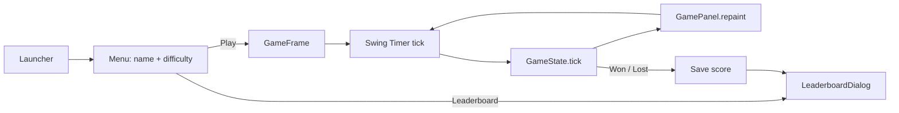

# Shot the Ball


A small arcade shooting game written in **Java 17 + Swing**. Balls bounce around the board and you shoot them with the mouse until they break. Every hit changes the ball colour:

🔵 → 🟢 → 🟡 → 🟠 → 🔴

Escaping balls cost lives. When the lives run out — or too many balls escape — the game is over and the score is stored in a persistent leaderboard.

> [!NOTE]
> This repository is a clean rewrite of an earlier university project. The look and feel of the original UI were kept on purpose; what changed is the internals: model/UI/audio separation, an EDT-driven game loop, classpath resources and real JUnit tests.

---

## At a glance

| | |
|---|---|
| **Language** | Java 17 |
| **UI** | Swing (`JFrame`, `JPanel`, custom cursor) |
| **Game loop** | `javax.swing.Timer` at ~60 FPS, always on the EDT |
| **Artwork** | Hand-drawn by the author in MS Paint |
| **Persistence** | Serialized leaderboard in `~/.shottheball/leaderboard.dat` |
| **Tests** | 13 JUnit 5 tests, no GUI automation required |
| **Build** | Maven (`mvn test`, `mvn package`) |

## How it plays



### Difficulty levels

| Level | Balls at start | Ball size | Game over after |
|:--|--:|--:|--:|
| `Easy` | 10 | 35 px | 25 escaped balls |
| `Normal` | 20 | 30 px | 30 escaped balls |
| `Hard` | 30 | 30 px | 35 escaped balls |

### Controls

| Action | Result |
|---|---|
| Enter nickname, pick difficulty, **Play** | Starts a new game |
| **Left click** on a ball | Fires; five hits destroy it |
| **Left click** with an empty magazine | Reloads (14 rounds), no shot consumed |
| **Leaderboard** in the launcher | Opens the all-time ranking |

Scores award **+1000** for a win and subtract elapsed time according to the difficulty.

## Build and run

Requirements: **JDK 17+** and Maven.

```bash
mvn package
java -jar target/shot-the-ball-1.0.0-jar-with-dependencies.jar
```

The fat JAR contains classes, images and sounds, so it runs from any directory. To run straight from the sources:

```bash
mvn exec:java -Dexec.mainClass=com.rolandoepdw.shottheball.ShotTheBall
```

## Tests

```bash
mvn test
```

| Test class | What it verifies |
|---|---|
| `BallTest` | Bounce on all four edges; a single move per tick |
| `GameStateTest` | Hits, destruction, lives, ammo/reload, end of game |
| `LeaderboardTest` | Descending order and round-trip persistence with `@TempDir` |

No real user data is touched by the tests.

<details>
<summary><b>What changed under the hood (click to expand)</b></summary>

- The old `Tablero` called `join()` from inside its own `run()` and had an unbounded `while(true)`; the loop is now a `Swing Timer` with a real terminal state.
- Swing was previously repainted from a worker thread; now every UI mutation happens on the EDT.
- Assets used relative paths like `src/images/...`; they are now loaded from the classpath and work from the JAR.
- String comparisons with `==` were replaced by `equals`.
- The leaderboard uses a typed `Comparable<LeaderboardEntry>` instead of a raw `Comparable`.
- Audio has no busy-wait thread; clips close themselves on `LineEvent.Type.STOP`.

</details>

## Project layout

```text
src/main/java/com/rolandoepdw/shottheball/
├── ShotTheBall.java          # entry point
├── model/                    # Ball, GameState, Difficulty, Leaderboard, LeaderboardEntry
├── ui/                       # launcher, menus, game panel, leaderboard, resource loading
└── audio/SoundPlayer.java    # WAV playback from the classpath
src/main/resources/
├── images/                   # original artwork and crosshair
└── sounds/                   # WAV effects
src/test/java/...             # JUnit 5 tests
```

## License

MIT — Copyright (c) 2026 Rolandoepdw. See [LICENSE](LICENSE).
